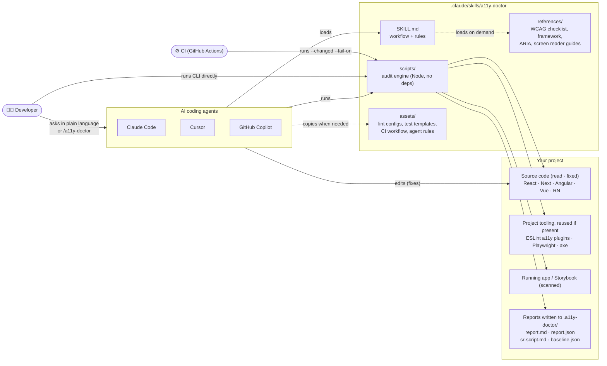
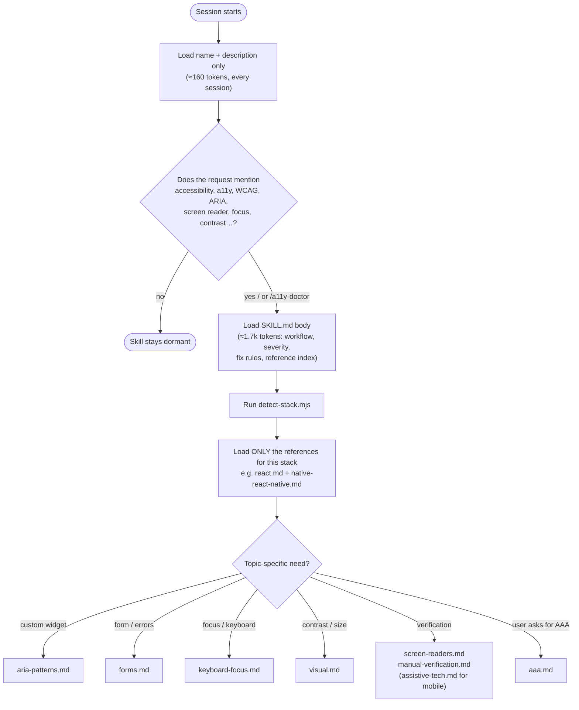
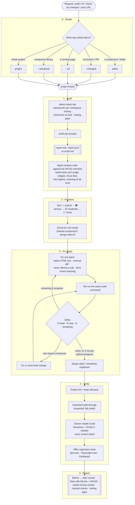
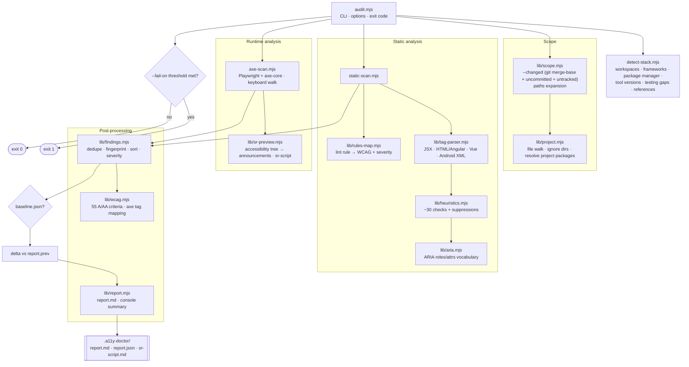
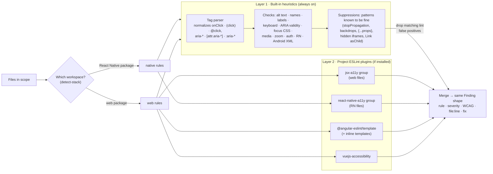
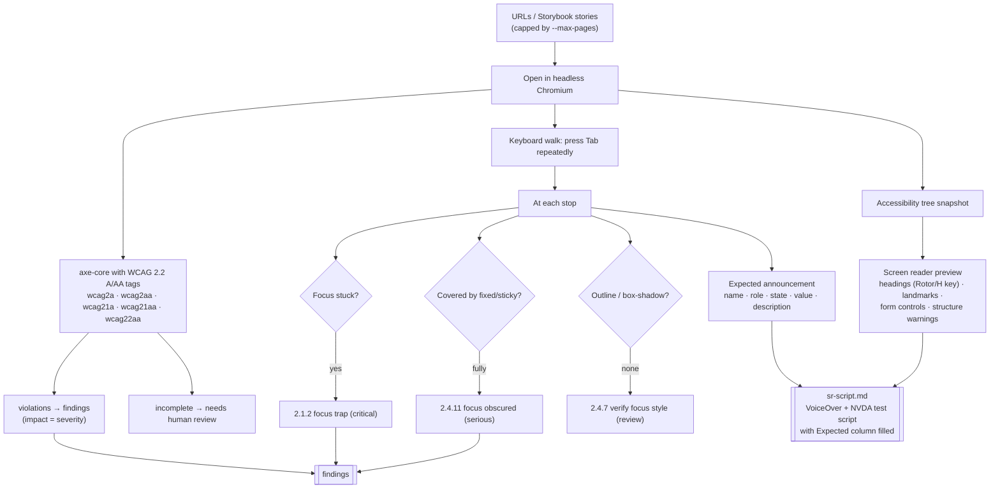
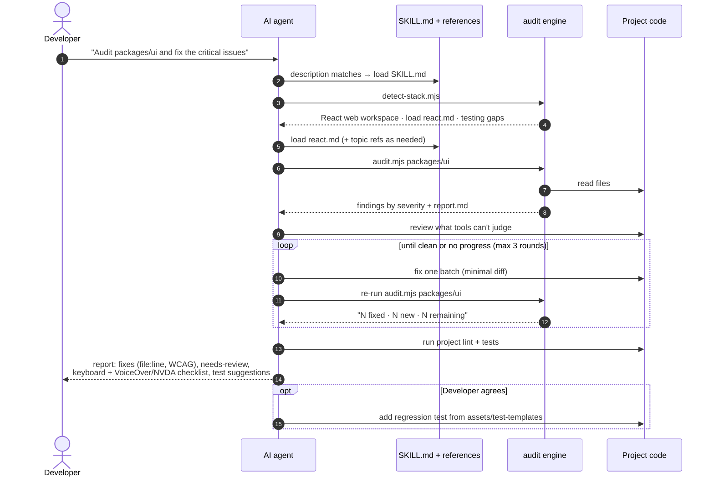
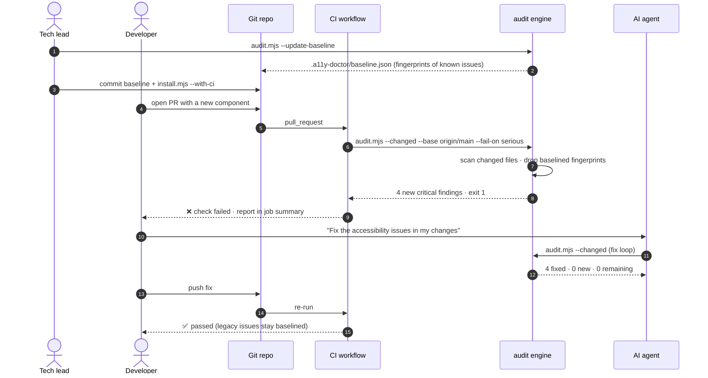
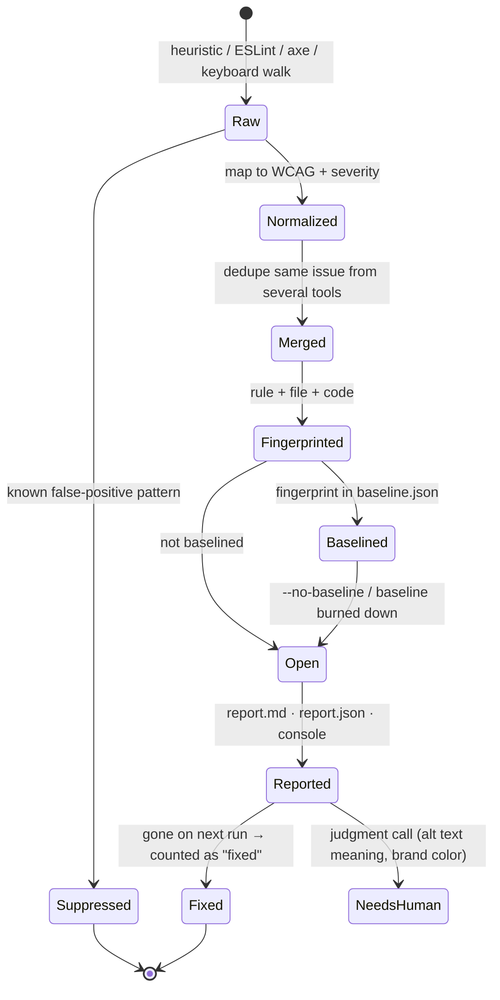

# A11y Doctor architecture

How the skill and its engine audit, fix and verify accessibility issues. The diagrams are
[Mermaid](https://mermaid.js.org), which renders on GitHub and in most Markdown viewers.

1. [System overview](#1-system-overview): who talks to what
2. [How an agent loads the skill](#2-how-an-agent-loads-the-skill): progressive disclosure
3. [Audit → Fix → Verify flow](#3-audit--fix--verify-flow): the end-to-end process
4. [Audit engine internals](#4-audit-engine-internals): what `audit.mjs` does
5. [Static analysis pipeline](#5-static-analysis-pipeline): heuristics + ESLint, per workspace
6. [Runtime analysis pipeline](#6-runtime-analysis-pipeline): axe + keyboard walk + screen reader preview
7. [Agent session sequence](#7-agent-session-sequence): one request, start to finish
8. [Team workflow: baseline and PR gate](#8-team-workflow-baseline-and-pr-gate)
9. [Finding lifecycle](#9-finding-lifecycle): from raw result to report
10. [Design principles](#10-design-principles)

---

## 1. System overview

- **One skill folder serves three agents.** Claude Code, Cursor and Copilot all read
  `.claude/skills/`.
- **The engine has no dependencies.** It *reuses* the project's own ESLint plugins and
  Playwright when present, and falls back to its built-in checks when they're not.
- **The same scripts serve three callers:** the agent, a developer at the terminal, and CI.

---

## 2. How an agent loads the skill

Agents load skills in stages ("progressive disclosure"), so the skill costs little until
it's needed. Token figures are estimates (≈4 characters per token); `npm run validate`
prints the current sizes.

| Stage | When | ≈ Tokens |
|---|---|---|
| Name + description | every session, in every agent with the skill installed | ≈160 |
| `SKILL.md` body | when accessibility comes up | ≈1.7k |
| Framework + topic reference | when fixing (e.g. `react.md` + `forms.md`) | ≈2.5k |
| WCAG checklist | only for the manual-review part of an audit | ≈3k |
| Scanner output | console summary, grouped by rule | usually < 1k |
| All references | never loaded together | ≈21k |

The description is longer than the ~100-token norm on purpose: its trigger words
(VoiceOver, NVDA, ARIA, contrast, focus…) are how agents decide to activate the skill.

How the token cost is kept down:
- **Grouped output**: findings are grouped by rule in the console and `report.md`, so a rule's
  message, WCAG criterion and fix are printed once, not per instance. In a 46-finding example,
  `report.md` went from ≈6.7k to ≈3.7k tokens. `--rule <id>` lists every location of one rule
  when fixing it.
- **Reading rules in `SKILL.md`**: start from the console summary, never read `report.json`
  or script source, and load references only per stack and topic.
- **Split references**: core screen reader guidance (`screen-readers.md`) is separate from
  mobile, JAWS and Guidepup material (`assistive-tech.md`).

---

## 3. Audit → Fix → Verify flow

The core process the skill teaches the agent.

---

## 4. Audit engine internals

`scripts/audit.mjs` orchestrates the modules. Everything is plain Node.js (20+), with no
install step.

---

## 5. Static analysis pipeline

Two layers run on every file. The built-in heuristics always run. The project's own ESLint
a11y plugins add depth when installed. Each plugin runs in isolation, so one broken parser
can't disable the others.

---

## 6. Runtime analysis pipeline

For `--url` and `--storybook`. It uses the project's Playwright and `@axe-core/playwright`.

---

## 7. Agent session sequence

One request, start to finish, e.g. *"Audit packages/ui and fix the critical issues"*.

---

## 8. Team workflow: baseline and PR gate

Legacy issues are recorded once, so checks only fail on **new** problems.

Fingerprints are built from *rule + file + offending code*, not line numbers, so unrelated
edits that shift lines don't make baselined issues reappear.

---

## 9. Finding lifecycle

| Severity | Meaning | Typical examples |
|---|---|---|
| 🔴 critical | Blocks a task for keyboard or screen reader users | unlabeled input, click-only `div`, focus trap, icon button with no name |
| 🟠 serious | Major barrier | low contrast, focus hidden by sticky header, invalid ARIA, no captions |
| 🟡 moderate | Harder to use | missing RN role, hover-only content, autofocus |
| ⚪ minor | Polish / verify | vague link text, modal backdrop (verify Escape) |

---

## 10. Design principles

| Principle | How it shows up |
|---|---|
| **Portable** | One `SKILL.md` using only Agent Skills spec fields; works in Claude Code, Cursor and Copilot. `npm run validate` enforces this. |
| **Cheap until needed** | ≈160 tokens idle (name + description); ≈1.7k for `SKILL.md` when activated; references load per stack and topic, never all at once; scanner output is grouped by rule. |
| **Zero setup, more with setup** | Built-in checks need only Node; the project's ESLint plugins and Playwright add depth automatically. |
| **Precision over noise** | Checks stay quiet when code *might* be fine; known false-positive patterns are suppressed and counted. Evals fail on any false positive. |
| **Measurable loop** | Fingerprints make "fixed / new / remaining" exact across runs. |
| **Humans for judgment** | Meaning, brand colors and screen reader experience go to "needs human review", with a ready test script. |
| **Safe by default** | The agent asks before installing packages, starting servers, changing shared design systems, or running a screen reader. |
| **Adoptable by teams** | Baseline + `--changed` + `--fail-on` lets legacy repos block only new issues. |
